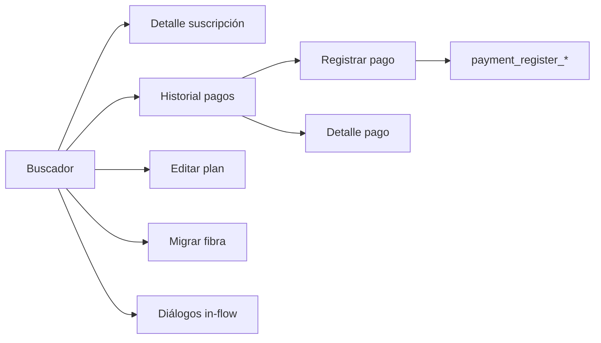

# Observabilidad: buscador de suscripciones e historial de pagos

**Fecha**: 2026-07-14

## Pantallas cubiertas

| Pantalla | Archivo principal |
|----------|-------------------|
| Buscador de suscripciones | `SubscriptionFinderScreen.kt` |
| Tarjeta y formulario cliente | `SubscriptionCard.kt`, `CardHeader.kt` |
| Diálogos in-flow | `ChangeNapBoxDialog.kt`, `LocationUpdateDialog.kt` |
| Detalle de suscripción (subflujo) | `SubscriptionDetailScreen.kt` |
| Historial de pagos (subflujo) | `PaymentHistoryContent.kt`, `PaymentHistoryComposeScreen.kt` |
| Registro de pago (subflujo) | `RegisterPaymentScreen.kt` |

## Convención

- Prefijo `subscription_search_*` para búsqueda y filtros.
- Prefijo `subscription_result_*` para resultados (sufijo `_{subscriptionId}`).
- Prefijo `payment_history_*` para historial.
- Prefijo `payment_register_*` para registro de pago.
- Prefijo `subscription_detail_*` para detalle.
- Clicks: automáticos vía `ObservabilityComposeGestureLocator`.

- Texto: `ObservabilityComposeText.report()` en campos de búsqueda, formulario cliente, notas de reactivación, fechas y registro de pago (pagador, descuento).

## Mapa de tags — Registro de pago

| Tag | Control |
|-----|---------|
| `payment_register_back` | Volver |
| `payment_register_method` | Método de pago |
| `payment_register_electronic_payer` | Nombre pagador (Yape/Plin) |
| `payment_register_discount_toggle` | Activar descuento |
| `payment_register_discount_amount` | Monto de descuento |
| `payment_register_discount_reason` | Razón del descuento |
| `payment_register_submit` | Registrar pago |
| `payment_register_success_dismiss` | Aceptar (éxito) |

## Mapa de tags — Buscador

### Filtros y consulta

| Tag | Control |
|-----|---------|
| `subscription_search_query` | Caja única: nombre, DNI/RUC, IP o código (propuesta A, 2026-10-17) |
| `subscription_search_by_date` | Botón buscar por fecha de alta |
| `subscription_search_clear` | Limpiar la caja |
| `subscription_search_chip_{filtro}` | Chips Todos, Con deuda, Cortados, Fibra, Inalámbrico, Solo TV |
| `subscription_search_quick_{estado}` | Accesos rápidos (cut_off, cancelled) |
| `subscription_search_recent_{id}` | Suscripción reciente |
| `subscription_search_clear_recents` | Borrar recientes |
| `subscription_search_date_start` | Fecha inicial |
| `subscription_search_date_end` | Fecha final |
| `subscription_search_date_submit` | Botón buscar por fechas |
| `subscription_search_date_picker_confirm` | Aceptar date picker |
| `subscription_search_date_picker_dismiss` | Cancelar date picker |

### Resultados (`{id}` = subscriptionId)

| Tag | Control |
|-----|---------|
| `subscription_result_item_{id}` | Tarjeta de resultado |
| `subscription_result_expand_{id}` | Expandir/colapsar detalle |
| `subscription_result_menu_{id}` | Menú de opciones |
| `subscription_result_menu_payment_history_{id}` | Ver historial de pagos |
| `subscription_result_menu_edit_plan_{id}` | Editar plan |
| `subscription_result_menu_see_details_{id}` | Ver detalle |
| `subscription_result_menu_migrate_fiber_{id}` | Migrar a fibra |
| `subscription_result_menu_cancel_{id}` | Cancelar suscripción |
| `subscription_result_menu_reactivate_{id}` | Reactivar servicio |
| `subscription_result_menu_change_nap_box_{id}` | Cambiar NAP Box |
| `subscription_result_menu_update_location_{id}` | Actualizar ubicación |
| `subscription_result_menu_reboot_onu_{id}` | Reiniciar ONU |
| `subscription_result_map_{id}` | Abrir mapa |
| `subscription_result_whatsapp_{id}` | WhatsApp |
| `subscription_result_ip_{id}` | Abrir IP en navegador |
| `subscription_result_customer_name_{id}` | Nombre (formulario) |
| `subscription_result_customer_last_name_{id}` | Apellido |
| `subscription_result_customer_phone_{id}` | Teléfono |
| `subscription_result_customer_dni_{id}` | DNI |
| `subscription_result_customer_place_{id}` | Lugar |
| `subscription_result_customer_address_{id}` | Dirección |
| `subscription_result_customer_email_{id}` | Email |
| `subscription_result_customer_save_{id}` | Guardar cliente |

### Diálogos

| Tag | Control |
|-----|---------|
| `subscription_cancel_dialog_dismiss` / `_confirm` | Cancelar suscripción |
| `subscription_reactivate_dialog_dismiss` / `_confirm` | Reactivar servicio |
| `subscription_reactivate_notes` | Notas de reactivación |
| `subscription_reboot_dialog_dismiss` / `_confirm` | Reiniciar ONU |
| `subscription_nap_box_dropdown` / `_confirm` / `_close` | Cambiar NAP Box |
| `subscription_location_back` / `_map` / `_gps` / `_cancel` / `_update` | Actualizar ubicación |

## Mapa de tags — Detalle de suscripción

| Tag | Control |
|-----|---------|
| `subscription_detail_call` | Llamar |
| `subscription_detail_whatsapp` | WhatsApp |
| `subscription_detail_facade_photo` | Foto de fachada |
| `subscription_detail_facade_dialog_camera` | Tomar foto |
| `subscription_detail_facade_dialog_gallery` | Galería |
| `subscription_detail_facade_full_update` | Actualizar foto (vista ampliada) |
| `subscription_detail_facade_full_close` | Cerrar vista ampliada |

## Mapa de tags — Historial de pagos

| Tag | Control |
|-----|---------|
| `payment_history_filter_pending` | Solo pendientes |
| `payment_history_restore_connection` | Restablecer conexión |
| `payment_history_item_{paymentId}` | Ítem de pago |
| `payment_history_reactivation_notes` | Notas de reactivación (sección opcional) |
| `payment_history_reactivate_submit` | Botón reactivar |

## Subflujos de navegación desde el buscador



Los subflujos **Detalle**, **Historial de pagos** y **Registro de pago** tienen tags completos. Editar plan y migración se abren por menú pero aún no tienen `TestTags` dedicados (fuera del alcance de esta iteración).

## Archivos de constantes

- `SubscriptionFinderTestTags.kt`
- `PaymentHistoryTestTags.kt`
- `RegisterPaymentTestTags.kt`

- `SubscriptionDetailTestTags.kt`

## Pruebas

- `SubscriptionFinderTestTagsTest.kt` — constantes, helpers dinámicos y verificación de wiring en fuentes Compose (incluye registro de pago).

## Build

```bash
./gradlew compileDevDebugSources :presentation:testDevDebugUnitTest \
  --tests "com.dscorp.ispadmin.presentation.ui.features.subscriptionfinder.compose.*"
```
